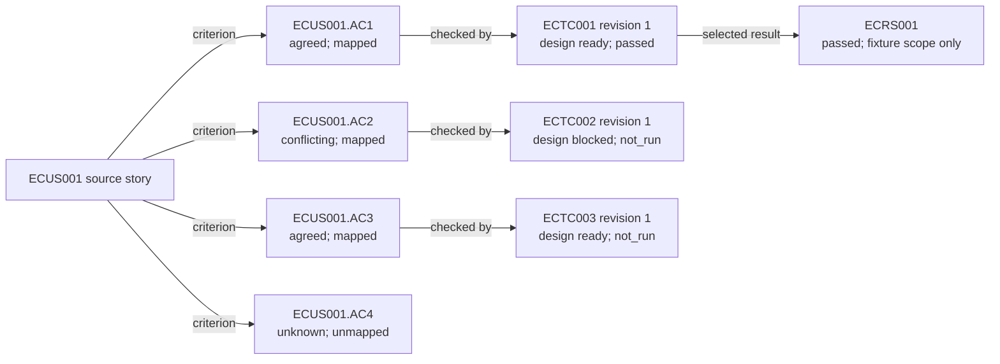

# Evidence Check — Test Coverage

Scope: declared criteria in the synthetic query workflow.
Coverage basis: supplied_criteria_only

## Criteria

| Criterion ID | Story | Decision status | Mapped tests | Current verification | Gaps |
| --- | --- | --- | --- | --- | --- |
| ECUS001.AC1 | ECUS001 | agreed | ECTC001 | verified in the named SQL fixture | no authentication or application check |
| ECUS001.AC2 | ECUS001 | conflicting | ECTC002 | unverified | unresolved null rule; design blocked; no result |
| ECUS001.AC3 | ECUS001 | agreed | ECTC003 | unverified | planned boundary case; no result |
| ECUS001.AC4 | ECUS001 | unknown | none | unverified | no measurable performance bound or test |

## Test evidence

| Test ID | Design state | Selected result | Reported status | Current | Evidence or gap |
| --- | --- | --- | --- | --- | --- |
| ECTC001 | ready | ECRS001 | passed | yes | fixture-result.json; source query case revision 1 |
| ECTC002 | blocked | none | not_run | no | no accepted oracle or execution |
| ECTC003 | ready | none | not_run | no | design exists; execution does not |

## Summary and limits

Four declared criteria; three mapped criteria; one verified criterion in the named fixture scope.
No complete-coverage or release-readiness claim follows from these counts.
The helper's full output is in coverage-summary.json. The target application has not been tested.

## Coverage map

Legend: story to criterion to test to selected result. An unrun test has no result node.
The unknown performance criterion stays visible without an invented test or threshold.

## Review actions

Resolve the null-handling conflict, execute the empty-population case, and agree the performance requirement.
Confirm runtime access controls and product outcome measures before a release decision.
