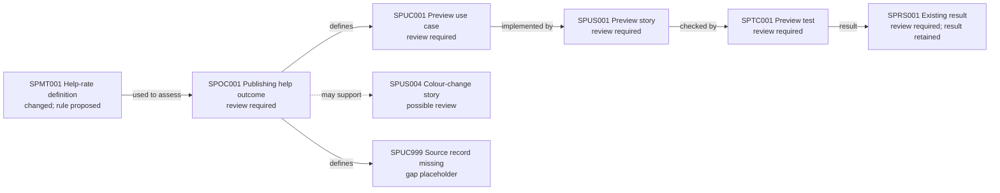

# Support Portal — Change Impact

Changed records: SPMT001
Proposed change: exclude unknown help flags from the denominator and report them separately.
Scope and coverage: selected synthetic trace register; partial because SPUC999 has no supplied source record.

## Required review from recorded links

| Record ID | Kind | Link path and source | Review action | Owner |
| --- | --- | --- | --- | --- |
| SPOC001 | outcome | SPMT001 → SPOC001; input.md SPMT001 | check the success measure and historical comparability | unknown |
| SPUC001 | use_case | SPOC001 → SPUC001; input.md SPOC001 | check the recorded outcome link and scope | unknown |
| SPUS001 | story | SPUC001 → SPUS001; input.md SPUC001 | check whether acceptance intent needs a change | unknown |
| SPTC001 | test | SPUS001 → SPTC001; input.md SPUS001 | review what this test demonstrates about the outcome | unknown |
| SPRS001 | result | SPTC001 → SPRS001; input.md SPTC001 | review relevance; do not turn the passed layout check into a failure | unknown |

These records need review through the documented links. The analysis does not prove that their values or implementation must change.

## Possible review

SPUS004 is reached through a proposed association from SPOC001, recorded in input.md SPUS004.
Confirm that association before treating the colour change as outcome-related work.

## Gaps and limits

The link SPOC001 → SPUC999 is supplied, but its target record is missing.
No dependent work beyond that missing record can be established from this register.
Upstream research and problem records are outside the downstream view, not proven unaffected.
Other unrecorded dependencies may exist. No source artifact or decision has been changed.

## Impact map

Legend: recorded links are solid; proposed links are dashed. The missing-record box is a gap placeholder.
Labels distinguish the changed metric, required review, and possible review. They do not show actual business effects.

## Decisions and next actions

Check historical populations and null treatment before comparing the new metric with earlier figures.
Find SPUC999 and its downstream records. Confirm or reject the proposed link to SPUS004.
Retain existing test results until their evidence is reviewed. No automatic backlog update or new result is implied.
