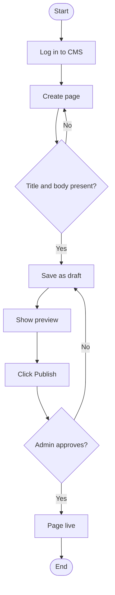

# NW — User Flow: NWEP001 Self-service publishing

Legend: rounded = start/end, rectangle = action, diamond = decision.

Assumption: the approval workflow is configured. If it is not, the publish step goes straight from preview to live.
