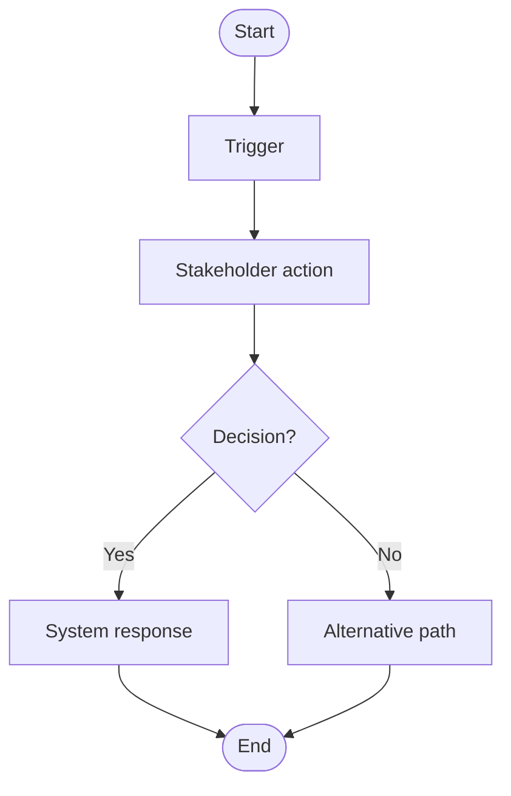

# Templates — User Flow

Three outputs per diagram: Mermaid (always), draw.io XML (always), PNG (when the `drawio` CLI is installed).

## Mermaid

One diagram per EPIC. Direction: top-down (`flowchart TD`).

### Node shapes

| Shape | Meaning | Mermaid syntax |
| :--- | :--- | :--- |
| Rounded | Start / end | `id([label])` |
| Rectangle | Action | `id[label]` |
| Diamond | Decision | `id{label}` |

### Rules

- Labels: verb + noun. Short. No full sentences.
- Decision branches: label every edge (`-- Yes -->`, `-- No -->`).
- Node IDs: short, unique, no spaces.

### Skeleton

````markdown
# [PN] — User Flow: [EPIC ID] [EPIC name]


````

## draw.io XML

Same shapes and labels as the Mermaid version, so both match. Structure:

```xml
<mxfile host="app.diagrams.net">
  <diagram name="[EPIC ID] [EPIC name]">
    <mxGraphModel>
      <root>
        <mxCell id="0"/>
        <mxCell id="1" parent="0"/>
        <!-- one mxCell per node: style="rounded=1" start/end, "rounded=0" action, "rhombus" decision -->
        <!-- one mxCell per edge with source/target -->
      </root>
    </mxGraphModel>
  </diagram>
</mxfile>
```

Rules: unique ids, `vertex="1"` on nodes, `edge="1"` on connectors, `parent="1"` throughout.

## PNG

Render only when the CLI exists:

```bash
drawio -x -f png -o [PN]-user-flow-[EPIC-ID].png [PN]-user-flow-[EPIC-ID].drawio
```

If `drawio` is not on PATH, skip and note: `brew install --cask drawio`. Never fail.

## Lucidchart path

No integration. The `.drawio` file imports into Lucidchart via File → Import. This is deliberate: no accounts or secrets in this skill.
