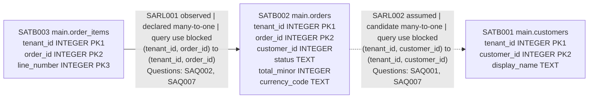

# Shop Analytics — Schema Map [VISUAL]

Handoff: needs_confirmation
Runtime controls: not_assessed
Source: SA-schema-model.json, inspection date 2026-11-23.

Legend: solid = observed or confirmed; dashed = assumed. Status labels determine query approval.

## Open questions and limits

Blocking questions: SAQ001, SAQ002, SAQ003, SAQ004, SAQ005, SAQ006, SAQ007.
Both relationships are blocked for query use. No SME answers have been supplied.
The source is supplied DDL. No live database or business rows were inspected.
Foreign key enforcement and historical data validity were not checked.
No objects or relationships were omitted. No rejected relationships exist in this model.
