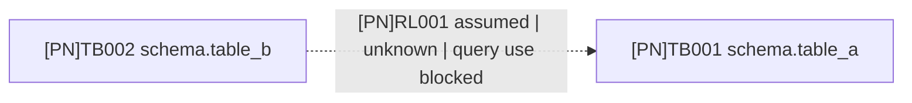

# Templates — Schema Map [VISUAL]

Use `flowchart LR`. A dashed line means an assumed relationship in this format.
Use labels as well as line styles so status remains clear in plain text.

## Table label

```text
[PN]TB001 schema.table
column_name TYPE PK1
column_name TYPE PK2
other_column TYPE
```

`PK1` and `PK2` show positions in the primary key. Label unique keys separately with their ordered columns.
Mark views as `view`. Do not add keys or columns that are absent from the model.
Escape Mermaid and XML labels for their respective formats. Preserve the displayed database names.

## Relationship label

```text
[PN]RL001 observed | declared many-to-one | query use blocked
(source_column_1, source_column_2) to (target_column_1, target_column_2)
Questions: [PN]Q001
```

For assumed relationships, use `assumed` and `candidate` instead of `observed` and `declared`.
For unknown cardinality, write `unknown`. An approved join uses `query use approved`.
Never change status to improve the appearance of the diagram.

## Markdown layout

````markdown
# [Project] — Schema Map [VISUAL]

Handoff: needs_confirmation
Runtime controls: not_assessed
Source: [model file and inspection date]

Legend: solid = observed or confirmed; dashed = assumed. Read status labels for query approval.



## Open questions and limits

[Blocking question IDs, source limits, omitted objects, and rejected relationship notes]
````

## draw.io

Use one `mxCell` with `vertex="1"` per table or view. Use one with `edge="1"` per relationship.
Use unique cell IDs, valid source and target IDs, and `parent="1"`.
Use `dashed=1` for assumed edges. Keep the same displayed labels and graph as Mermaid.
