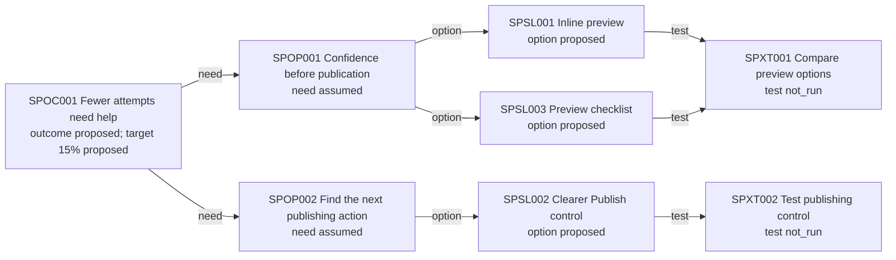

# Support Portal — Opportunity Assessment

Outcome: SPOC001 — fewer publishing attempts need developer help | Decision status: proposed
Baseline: 30%. Target: 15%, proposed and not agreed. Source: input.md E1.

## Opportunities and options

| Opportunity | Evidence and limits | Option | Expected benefit | Status | Open risk |
| --- | --- | --- | --- | --- | --- |
| SPOP001 — confidence before publication | input.md E2; small interview sample | SPSL001 — inline preview | may reduce uncertainty | proposed | users may still need help |
| SPOP001 — confidence before publication | input.md E2; same evidence | SPSL003 — preview checklist | may clarify what to check | proposed | checklist may add effort |
| SPOP002 — find the next publishing action | input.md E2; small interview sample | SPSL002 — clearer Publish control | may make the next action easier to find | proposed | may not address the logged help requests |

The opportunity statements are interpretations of the research. They are not confirmed causes of the baseline rate.

## Tests

| Test ID | Option | Assumption | Proposed test | Decision rule | Owner | Result |
| --- | --- | --- | --- | --- | --- | --- |
| SPXT001 | SPSL001, SPSL003 | preview support reduces uncertainty | compare both prototypes in the same publishing task | record task completion and help requests; agree pass criteria first | unknown | not_run |
| SPXT002 | SPSL002 | the publishing action can be found without help | observe the publishing task with the revised control | record task completion; agree pass criteria first | unknown | not_run |

## Recommendation

Compare the preview options and test the publishing control. Do not select a delivery option from interview counts alone.
Technical feasibility and business fit remain unconfirmed. Preserve administrator approval from input.md E3.
No numeric test threshold, delivery estimate, or date is supplied.

## Opportunity map

Legend: labels state whether a need is assumed, an option is proposed, or a test is not_run.
Edges group ideas for assessment. They do not show proven impact.

