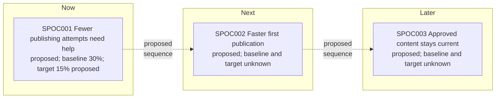

# Support Portal — Outcome Roadmap

Product Goal: let editors publish approved content without developer help.
Roadmap status: proposed
Horizons show relative sequence. No dates are implied.

## Roadmap

| Outcome ID | Horizon | Desired change | Evidence | Measure and target status | Hard prerequisites | Review condition | Owner | Decision status |
| --- | --- | --- | --- | --- | --- | --- | --- | --- |
| SPOC001 | Now | Fewer publishing attempts need developer help | input.md E1–E2 | baseline 30%; target 15%, proposed | none supplied | agree the measure and target; assess option evidence | unknown | proposed |
| SPOC002 | Next | Faster first publication | input.md E1–E2 | baseline and target unknown | none supplied | establish baseline and target; review the proposed sequence | unknown | proposed |
| SPOC003 | Later | Approved content stays current | input.md E1–E2 | baseline and target unknown | none supplied | define freshness and validate the need | unknown | proposed |

## Sequence and dependencies

| From | To | Type | Source or proposed reason |
| --- | --- | --- | --- |
| SPOC001 | SPOC002 | proposed sequence | input.md E2; review evidence before expansion |
| SPOC002 | SPOC003 | proposed sequence | input.md E2; review evidence before expansion |

No hard technical prerequisite has been supplied. The sequence is not a delivery commitment.

## Visual roadmap

Legend: dashed arrows show proposed sequence. Now, Next, and Later are undated horizons.
All outcome decisions remain proposed. Administrator approval must remain, from input.md E3.

## Open decisions

Agree the roadmap and the target for SPOC001. Define measures for SPOC002 and SPOC003.
Capacity, dates, and named owners remain unknown. No release date is proposed.
