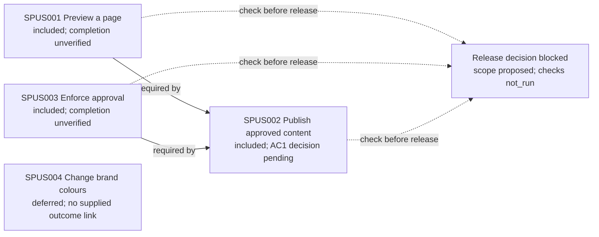

# Support Portal — Release Scope

Outcome: SPOC001 — fewer publishing attempts need developer help
Scope decision: proposed
Release status: blocked
Date and capacity: unknown

## Candidate scope

| Existing item ID | Included or deferred | Contribution or reason | Prerequisites | Source |
| --- | --- | --- | --- | --- |
| SPUS001 | included | preview the result before publication | none | input.md E3–E4 |
| SPUS002 | included | publish approved content for visitors | SPUS001, SPUS003 | input.md E1–E3 |
| SPUS003 | included | enforce the required approval boundary | none | input.md E2–E3 |
| SPUS004 | deferred | no supplied link to the release outcome | none | input.md E4 |

## Dependency checks

| Prerequisite | Dependent item | Included or already available | Evidence | Gap |
| --- | --- | --- | --- | --- |
| SPUS001 | SPUS002 | included | input.md E3 | no completion evidence supplied |
| SPUS003 | SPUS002 | included | input.md E3 | no completion evidence supplied |

The candidate scope contains both supplied prerequisites. This does not prove that either has been delivered.

## Release conditions

| Condition | Owner | Evidence | Result |
| --- | --- | --- | --- |
| Resolve SPUS002 AC1 against the approval rule | Product Owner; person unknown | input.md E2–E3 conflict | pending |
| Agree the candidate scope | Product Owner; person unknown | no decision supplied | pending |
| Demonstrate the complete approved publishing path | team; people unknown | no test evidence supplied | not_run |
| Supply and satisfy the team's quality conditions | team; people unknown | no Definition of Done or results supplied | not_run |

## Scope map

Legend: solid arrows show supplied prerequisites. Dashed arrows show checks before the release decision.
An included item is candidate scope, not completed work. The deferred colour change has no release path.

## Open decisions and non-goals

Confirm the scope, acceptance criteria, quality conditions, and test evidence before a release decision.
Capacity and dates are unknown. No completion or release approval is claimed.
Bypassing administrator approval and changing brand colours are outside this candidate release scope.
