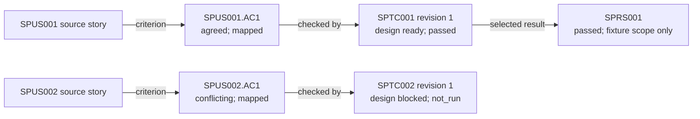

# Support Portal — Test Coverage

Scope: supplied synthetic criteria and test records at revision 1.
Coverage basis: supplied_criteria_only

## Criteria

| Criterion ID | Story | Decision status | Mapped tests | Current verification | Gaps |
| --- | --- | --- | --- | --- | --- |
| SPUS001.AC1 | SPUS001 | agreed | SPTC001 | verified within the supplied fixture evidence | target application unassessed |
| SPUS002.AC1 | SPUS002 | conflicting | SPTC002 | unverified | rule conflict; blocked design; no current result |

## Test evidence

| Test ID | Design state | Selected result | Reported status | Current | Evidence or gap |
| --- | --- | --- | --- | --- | --- |
| SPTC001 | ready | SPRS001 | passed | yes | supplied synthetic draft-validator record |
| SPTC002 | blocked | none | not_run | no | unresolved publication rule; no execution record |

## Summary and limits

Two declared criteria have mapped tests. One criterion has current passing evidence within the synthetic source record.
The other criterion is unresolved. The target application and wider test design have not been assessed.
This map does not establish release readiness.

## Coverage map

Legend: story → criterion → test → selected result. No result node exists for the unrun test.
Labels separate decision status, test design, and recorded execution status.

## Review actions

Resolve the publication rule. Complete and execute its test design in an authorised environment.
Assess other relevant cases and the target application before making a release decision.
