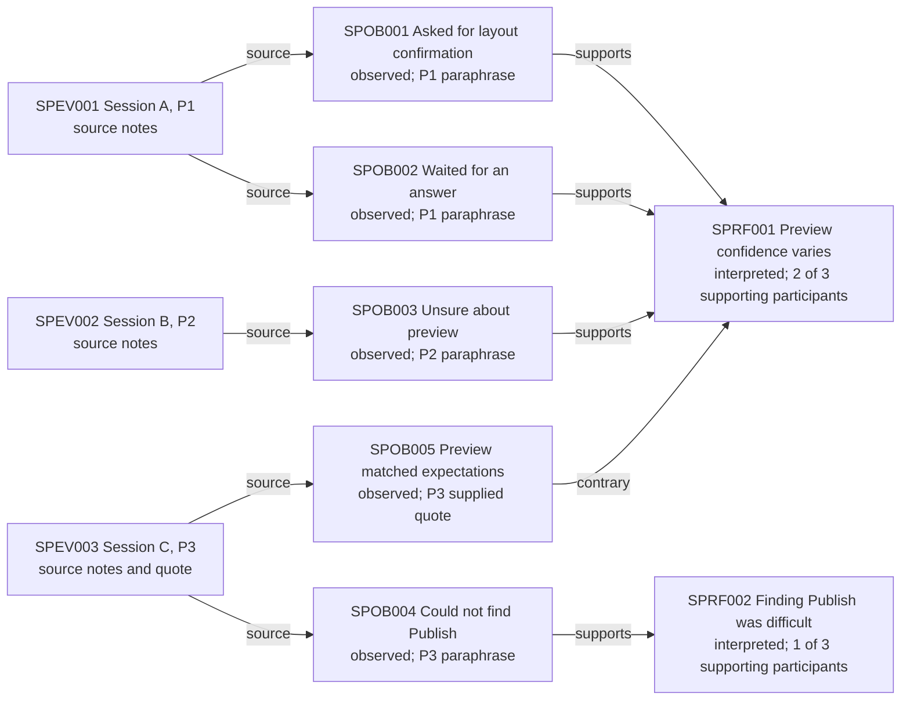

# Support Portal — Research Synthesis

Research question: what makes the publishing task difficult for these editors?
Scope: three fictional participants in one synthetic round. Recruitment and dates are unknown.
This round is separate from the earlier five-editor example. Do not combine the counts.

## Sources

| Evidence ID | Location | Study | Participant reference | Method and limits |
| --- | --- | --- | --- | --- |
| SPEV001 | input.md Session A | current round | P1 | session notes; recruitment unknown |
| SPEV002 | input.md Session B | current round | P2 | session notes; recruitment unknown |
| SPEV003 | input.md Session C | current round | P3 | session notes and supplied quote; recruitment unknown |

## Observations

| Observation ID | Participant | Observation or supplied quote | Form | Evidence ID and location |
| --- | --- | --- | --- | --- |
| SPOB001 | P1 | Asked a developer to confirm the page appearance after checking preview | paraphrase | SPEV001, first note |
| SPOB002 | P1 | Waited for an answer before continuing | paraphrase | SPEV001, second note |
| SPOB003 | P2 | Was uncertain whether preview reflected the live layout | paraphrase | SPEV002 |
| SPOB004 | P3 | Could not find Publish | paraphrase | SPEV003, first note |
| SPOB005 | P3 | The preview matched what I expected. | supplied quote | SPEV003, second note |

## Findings

| Finding ID | Interpretation | Supporting observations | Contrary observations | Distinct supporting participants | Limits |
| --- | --- | --- | --- | --- | --- |
| SPRF001 | Some participants lacked confidence about the preview | SPOB001, SPOB002, SPOB003 | SPOB005 shows a different experience | 2 of 3 | interpreted finding; repeated P1 notes count once; not population prevalence |
| SPRF002 | Finding the publishing action was difficult for one participant | SPOB004 | none supplied | 1 of 3 | interpreted finding; no claim about other editors |

## Proposed actions and questions

Investigate what produces the different preview experiences. Ask which publishing states the participants saw.
Check whether the action label or its location affected P3. These are proposed research actions, not agreed requirements.
No market prevalence, statistical significance, or product approval is established.

## Trace links

| From ID | To ID | Relationship | Link status | Source |
| --- | --- | --- | --- | --- |
| SPEV001 | SPOB001 | source | recorded | input.md SPEV001 |
| SPEV001 | SPOB002 | source | recorded | input.md SPEV001 |
| SPEV002 | SPOB003 | source | recorded | input.md SPEV002 |
| SPEV003 | SPOB004 | source | recorded | input.md SPEV003 |
| SPEV003 | SPOB005 | source | recorded | input.md SPEV003 |
| SPOB001 | SPRF001 | supports | recorded | observation and finding tables |
| SPOB002 | SPRF001 | supports | recorded | observation and finding tables |
| SPOB003 | SPRF001 | supports | recorded | observation and finding tables |
| SPOB005 | SPRF001 | contrary | recorded | observation and finding tables |
| SPOB004 | SPRF002 | supports | recorded | observation and finding tables |
| SPRF001 | SPPR001 | may inform | proposed | proposed interpretation for the supplied problem |
| SPRF002 | SPPR001 | may inform | proposed | proposed interpretation for the supplied problem |

## Evidence map

Legend: source observations are observed. Findings are interpreted. The `contrary` edge preserves P3's different preview experience.
The map does not count notes as independent participants or show an agreed product decision.

